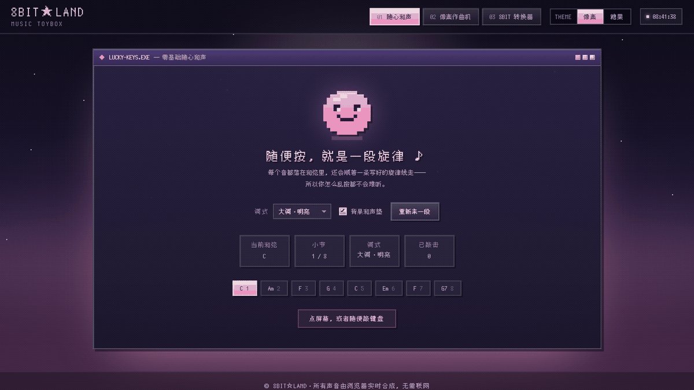
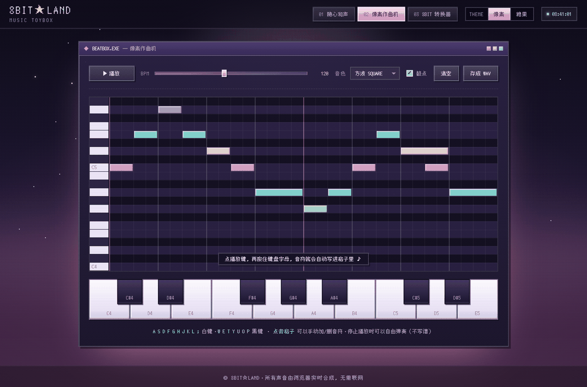
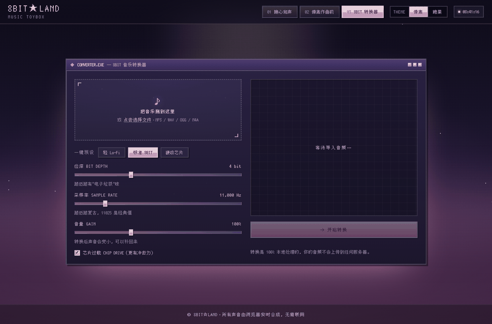
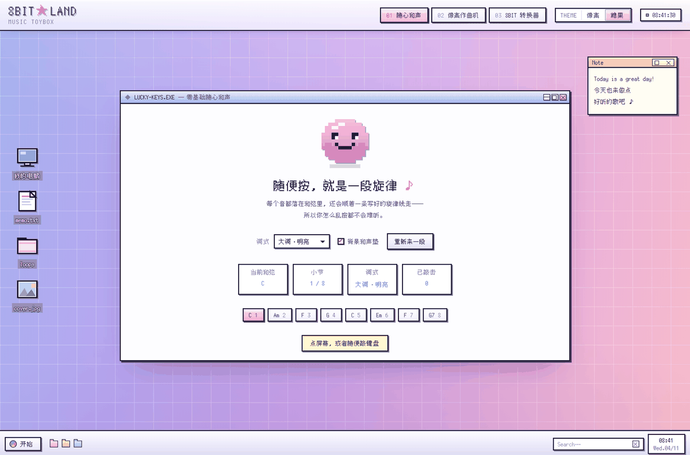

# 8BIT★LAND · 一个可以随手玩的 8bit 音乐工坊

没有安装、没有账号、没有素材库。打开网页就是三个窗口，所有声音都由浏览器实时合成——一个音频文件都没有。



纯静态：**3 个文件 + 内联字体，零外部依赖，双击 `index.html` 就能出声。**

| 整站加载 | 核心脚本 | 音频文件 |
| :--- | :--- | :--- |
| ≈ 1.9 MB | 59 KB | 0 个 |

---

## 三个互不依赖的入口

三个模块共用一套 Web Audio 合成引擎，但从哪个进去都能单独玩。

### 01 · 随心和声 `LUCKY.EXE`

按任意键就出一段旋律，和弦和调式自己配对。

- 8 小节一轮，和弦进行 `C – Am – F – G | C – Em – F – G7` 循环
- 强拍只落和弦音，级进优先，大跳之后反向补回来，导音必须解决
- 四套调式：大调‧明亮 / 小调‧温柔 / 多利亚‧慵懒 / 都节‧和风

### 02 · 像素作曲机 `BEATBOX.EXE`

16 步 × 13 个半音（C4–C5）的钢琴卷帘，点格子写音符。



- 字母键当琴键：`A S D F G H J K L` 白键，`W E T Y U O P` 黑键
- 四种波形：方波 / 窄脉冲 / 三角 / 锯齿，外加白噪声鼓点
- BPM、音色、鼓点开关、清空、**存成 WAV** 全在顶栏一行

### 03 · 8BIT 转换器 `CONVERTER.EXE`

把一首歌压回芯片里：拖入 `MP3 / WAV / OGG / M4A`，转成 8bit 味的 WAV。



处理链：`decodeAudioData` → 混单声道 → 抗混叠低通 → 降采样 → 位深量化 → 芯片过载 → 手写 WAV 编码。

三个预设：轻 Lo-Fi / 标准 8BIT / 硬核芯片。「标准 8BIT」= **4 bit / 11,000 Hz**。
全程在浏览器本地跑，音频不上传。

---

## 两套皮肤，一套骨架

右上角一键切换主题，配色全部收在 CSS 变量里，切主题只改 `<html>` 上的一个 `data-theme`；画布里的像素小人读同一份调色板，HTML 和 canvas 不会各走各的。

| 像素（默认） | 糖果桌面 |
| :--- | :--- |
|  |  |

---

## 跑起来

```bash
git clone <仓库地址>
cd 8bit

# 方式一：直接双击 index.html
# 方式二：起一个静态服务器
python -m http.server 8080
# 然后打开 http://localhost:8080
```

不需要 Node、不需要构建、不需要 `npm install`。

---

## 目录结构

```
8bit/
├── index.html          # 页面骨架：三个面板 + 顶栏 + 主题开关
├── styles.css          # 全部样式，含两套主题的 CSS 变量
├── app.js              # 合成引擎、旋律生成、转换链、画布绘制
├── fonts/pixel/
│   ├── hzk12.css       # 中文点阵字体（base64 内联，主力）
│   ├── hzk12-full.woff2
│   ├── pixel-inline.css# Fusion Pixel 12px（内联备用字形）
│   └── *.woff2         # Fusion Pixel 分片
└──docs/               # README 截图
```

---

## 几个实现细节

- **合成**：`OscillatorNode` + `GainNode` 手搓包络，鼓是白噪声过包络，没有任何采样文件。
- **旋律生成**：每个拍点先按当前和弦算可用音级，再按「级进优先、跳进后反向」挑音，最后检查导音是否解决。
- **8bit 转换**：先做抗混叠低通再抽降采样，避免高频折返成噪声；量化后可选「芯片过载」把音量推到失真。
- **像素字体**：点阵字体的 em 框就是 12 像素，所以字号只用 **12 的倍数**（12 / 24 / 36 / 48 / 96 / 120），非整数倍缩放会被插值，边缘立刻发灰。
- **主题**：`data-theme="vapor"`（像素蒸汽波）与 `data-theme="win98"`（糖果复古桌面），canvas 配色由 JS 里的 `PALETTES` 同步。

---

## 浏览器兼容

需要支持 Web Audio API 与 `decodeAudioData` 的现代浏览器（Chrome / Edge / Firefox / Safari 均可）。
移动端能玩，但字母键映射只在桌面端有意义。

刷新页面会重置当前编排，只有主题选择会被记住（`localStorage`）。

---

## 字体与授权

- `fonts/pixel/hzk12.css` — **M+ HZK12**（12px 中文点阵字体）子集，base64 内联，供中文像素字形使用。
- `fonts/pixel/pixel-inline.css` — **Fusion Pixel 12px Proportional**（SIL Open Font License），作为缺字时的备用字形。

字体版权归原作者所有，二次分发或商用请遵循各自的原始许可。
